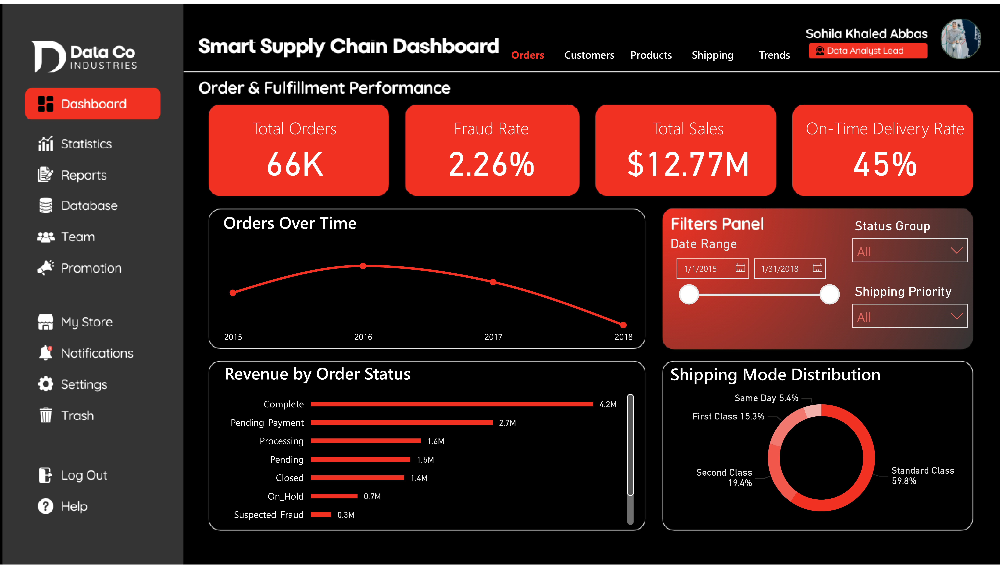
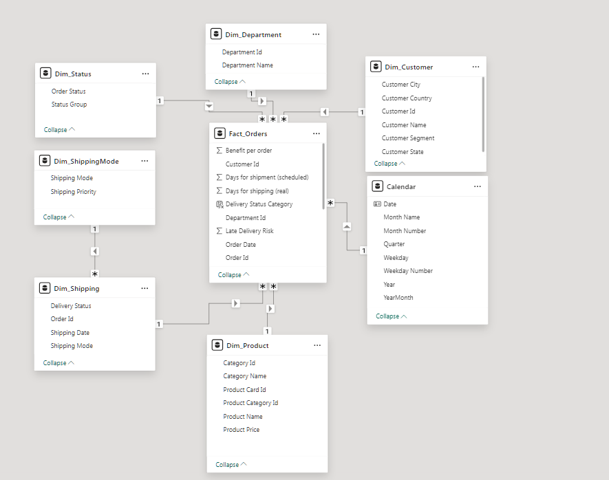
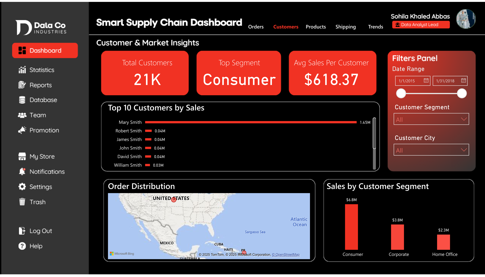
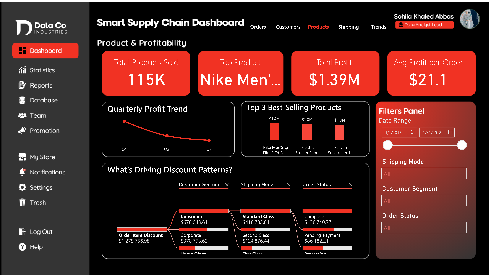
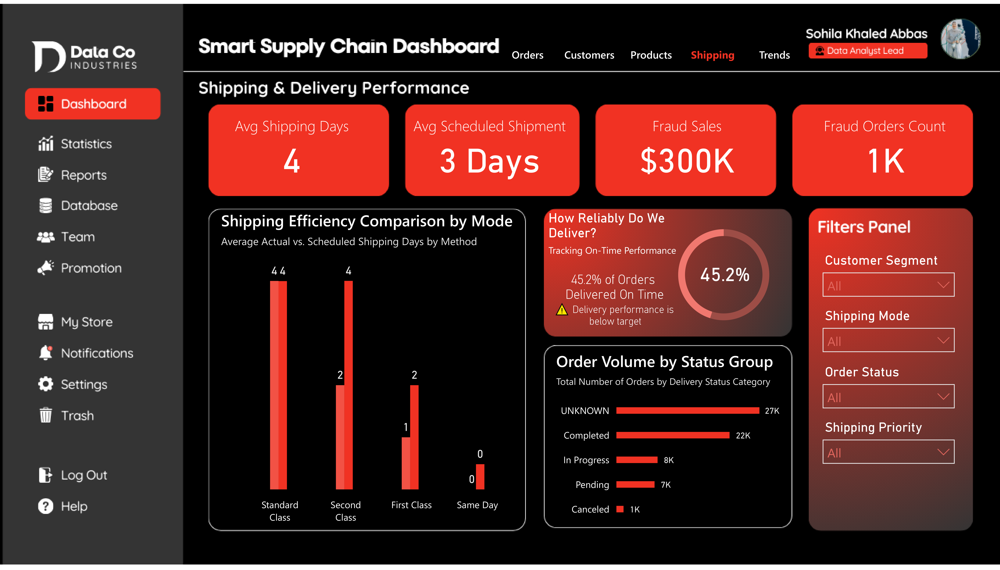
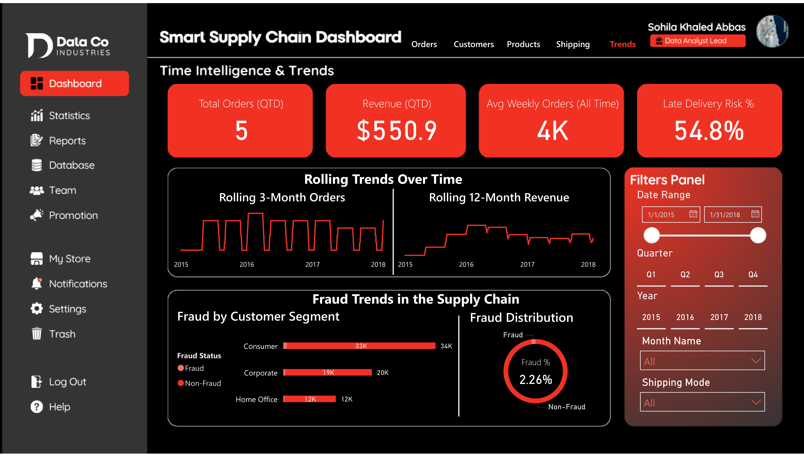

# 📦 SMART Supply Chain Insights Dashboard

### End-to-end analytics with Python, Excel, and Power BI

  A five-page business intelligence solution exploring order fulfillment, customer and market performance, product profitability, shipping operations, time trends, and fraud-related patterns.

  

  
  

  
  
  
  

  
  
  

  <strong><a href="https://app.powerbi.com/view?r=eyJrIjoiNzc1YzdkYWQtZDlkZC00MDhkLWJhNGEtZDg4YzRmMDI5NTljIiwidCI6IjI1Y2UwMjYxLWJiZDYtNDljZC1hMWUyLTU0MjYwODg2ZDE1OSJ9">Live dashboard</a></strong> ·
  <strong><a href="https://sohila-khaled-abbas.vercel.app/work/">Portfolio / selected work</a></strong> ·
  <strong><a href="https://github.com/Sohila-Khaled-Abbas/SMART-Supply-Chain-Insights-Dashboard">Source code</a></strong>

---

## 🎯 Project overview

This project turns a multi-year supply chain dataset into an interactive reporting experience. The workflow combines Python-based exploratory analysis and data preparation, Excel-based cleaning and dimensional modeling, and Power BI reporting with DAX measures.

The goal is to make operational and commercial patterns easier to investigate: order and fulfillment performance, customer and market behavior, product profitability, shipping and delivery, and trends over time.

> **Want to explore the result first?** Select the dashboard preview above to open the interactive Power BI report. You can also browse the project in my [portfolio](https://sohila-khaled-abbas.vercel.app/work/).

## 📊 Dataset at a glance

| Metric | Coverage |
|:--|--:|
| Unique orders | **65,752** |
| Unique customers | **20,652** |
| Unique products | **118** |
| Transaction period | **2015–2018** |
| First order date | 2015-01-01 |
| Last order date | 2018-01-31 |

The repository includes the source DataCo supply chain dataset, its descriptive data, a cleaned workbook, and the analysis and reporting assets.

## 🔄 End-to-end workflow

<table>
  <tr>
    <td width="52"><h3>01</h3></td>
    <td>
      <strong>Source data</strong> 
      Start with the raw supply chain dataset and its field descriptions in <strong>1_Raw_Data/</strong>.
    </td>
  </tr>
  <tr>
    <td><h3>02</h3></td>
    <td>
      <strong>Exploration and preparation</strong> 
      Use Python, Pandas, and visualization libraries to inspect distributions, trends, relationships, anomalies, and data quality. The notebook is in <strong>3_Python_EDA/</strong>.
    </td>
  </tr>
  <tr>
    <td><h3>03</h3></td>
    <td>
      <strong>Cleaned data and dimensional modeling</strong> 
      Review the cleaned Excel dataset in <strong>2_Cleaned_Data/</strong> and the documented star-schema workbook in <strong>4_Data_Modeling/</strong>.
    </td>
  </tr>
  <tr>
    <td><h3>04</h3></td>
    <td>
      <strong>Power BI semantic model and DAX</strong> 
      Use a DAX calendar table and time-intelligence measures, including MTD, QTD, YTD, and rolling metrics, to support consistent reporting.
    </td>
  </tr>
  <tr>
    <td><h3>05</h3></td>
    <td>
      <strong>Interactive reporting</strong> 
      Explore five report pages for fulfillment, customers and markets, profitability, shipping, and time trends in <strong>5_PowerBI_Dashboard/</strong>.
    </td>
  </tr>
</table>

## 🧱 Data model

The project documents a star-schema approach to organize the supply chain data for analytical reporting.

  
   
  Star schema and relationship overview · Select the image to view it at full size.

## 📈 Power BI report walkthrough

The dashboard is organized into five analytical views. Each preview links to the interactive report.

<table>
  <tr>
    <td width="50%" valign="top">
      
      <strong>01 · Order &amp; Fulfillment Performance</strong> 
      Order volume, fulfillment performance, and delivery-related KPIs.
    </td>
    <td width="50%" valign="top">
      
      <strong>02 · Customer &amp; Market Insights</strong> 
      Customer segments, geographic patterns, and market performance.
    </td>
  </tr>
  <tr>
    <td width="50%" valign="top">
      
      <strong>03 · Product &amp; Profitability</strong> 
      Product categories, sales, profit, and profitability patterns.
    </td>
    <td width="50%" valign="top">
      
      <strong>04 · Shipping &amp; Delivery</strong> 
      Shipping performance, delivery risk, and time-to-ship analysis.
    </td>
  </tr>
  <tr>
    <td colspan="2" valign="top">
      
      <strong>05 · Time Intelligence &amp; Trends</strong> 
      Period-based KPIs, seasonal patterns, rolling metrics, and trend exploration.
    </td>
  </tr>
</table>

  

## 🔎 Analysis and business questions

The exploratory analysis and report are designed to help investigate questions such as:

- How do order volumes and sales change across months and years?
- Which markets, regions, and customer segments contribute most to activity?
- Which product categories show stronger sales or profitability patterns?
- Where do shipping delays and delivery-risk patterns appear?
- How do fraud-related records differ across customer, geographic, and operational dimensions?
- How do discount rate, order quantity, and product price relate to profit per order?

### Analytical techniques

- **Data exploration:** numerical distributions, categorical breakdowns, trend analysis, and correlation analysis.
- **Data quality and anomalies:** z-score and IQR methods to identify unusual observations for further review.
- **Statistical exploration:** OLS regression to examine selected relationships with profit per order. The documented model has an **R² of 0.026**, so the included predictors explain only a small share of observed variation; the result should be treated as exploratory rather than a strong predictive model.
- **Business interpretation:** findings are used to frame follow-up questions and potential actions around discounting, pricing, fulfillment, and delivery performance.

## 🧰 Tools and technologies

| Area | Tools | Purpose |
|:--|:--|:--|
| Data preparation | Python, Pandas | Cleaning, transformation, and analysis |
| Exploratory analysis | Seaborn, Matplotlib, Plotly | Statistical and visual exploration |
| Statistical analysis | Statsmodels | Correlation and OLS regression |
| Spreadsheet work | Microsoft Excel | Cleaned data and schema documentation |
| Business intelligence | Power BI, DAX | Semantic modeling, KPIs, time intelligence, and interactive reporting |
| Version control | Git, GitHub | Project assets and documentation |

## 📁 Repository structure

<pre>
SMART-Supply-Chain-Insights-Dashboard/
├── 1_Raw_Data/
│   ├── DataCoSupplyChainDataset.csv
│   ├── DescriptionDataCoSupplyChain.csv
│   └── tokenized_access_logs.csv
├── 2_Cleaned_Data/
│   └── DataCo_cleaned.xls
├── 3_Python_EDA/
│   ├── EDA.ipynb
│   └── Python_Visualizations/
├── 4_Data_Modeling/
│   └── DataCo_StarSchema.xlsx
├── 5_PowerBI_Dashboard/
│   ├── SMART_SupplyChain_Dashboard.pbix
│   ├── StarSchema_Model.png
│   └── Dashboard_Page*.png
├── LICENSE
└── README.md
</pre>

## 🚀 Explore the project

### Option 1 — View the live report

Open the [interactive Power BI dashboard](https://app.powerbi.com/view?r=eyJrIjoiNzc1YzdkYWQtZDlkZC00MDhkLWJhNGEtZDg4YzRmMDI5NTljIiwidCI6IjI1Y2UwMjYxLWJiZDYtNDljZC1hMWUyLTU0MjYwODg2ZDE1OSJ9).

### Option 2 — Explore the source files

Clone the repository:

<pre><code>git clone https://github.com/Sohila-Khaled-Abbas/SMART-Supply-Chain-Insights-Dashboard.git
cd SMART-Supply-Chain-Insights-Dashboard</code></pre>

Then:

1. Open **3_Python_EDA/EDA.ipynb** to review the exploratory analysis.
2. Open **2_Cleaned_Data/DataCo_cleaned.xls** to inspect the cleaned dataset.
3. Open **4_Data_Modeling/DataCo_StarSchema.xlsx** to review the dimensional model.
4. Open **5_PowerBI_Dashboard/SMART_SupplyChain_Dashboard.pbix** in Power BI Desktop to inspect the report.

The published report is available online, so Power BI Desktop is not required to view the dashboard.

## 🔗 Connect with me

I'm **Sohila Khaled Abbas**, a BI Developer and Data Analyst focused on turning raw data into clear, decision-ready reporting.

  
  
  

- **Portfolio:** [Explore selected projects](https://sohila-khaled-abbas.vercel.app/work/)
- **LinkedIn:** [linkedin.com/in/sohilakhaledabbas](https://www.linkedin.com/in/sohilakhaledabbas)
- **GitHub:** [github.com/Sohila-Khaled-Abbas](https://github.com/Sohila-Khaled-Abbas)

## 📄 License

This project is released under the [MIT License](LICENSE).
